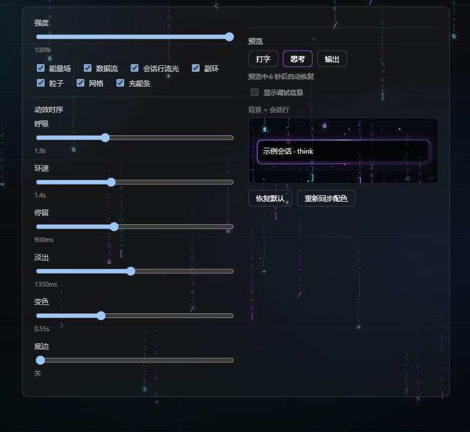

# 🛰 DSH 插件集

> 给 [DeepSeek Harness](https://github.com/) 桌面端做的两个独立插件：
> **科幻 HUD 状态光效** 与 **余额监控**。

两个插件互不依赖，**各自一个仓库**，可以只装其中一个。

## 📦 两个插件

### 🛰 科幻 HUD · 状态光效

> 整窗换成数据流背景，侧栏每个会话行按状态亮起光环或进度条。



- 思考：行外圈双环反向旋转（紫罗兰）
- 输出：行内呼吸填充向右推进（橙）
- 完成：补满 → 白光扫过 → 淡出
- 支持多会话并行，切会话不串行

**仓库** → <https://github.com/em-chester/dsh-plugin-hud>

### 💰 余额监控 · 水位条

> 侧栏一眼看清余额水位，不用再开浏览器查。

- 实时余额 + 水位条（≥¥50 绿 / ¥10–50 琥珀 / <¥10 红）
- 赠送 / 充值拆分、今日与本月消耗
- 低余额告警

**仓库** → <https://github.com/em-chester/dsh-plugin-balance>

## 🏪 插件市场

两个插件正在提交到 **awesome-dsh-plugin**（`dsh-market` 插件市场的来源列表）。
收录后可直接在侧栏 **插件市场** 里搜索安装，无需任何配置。

在此之前请用下方「直接安装」。

## 🛠 直接安装（不用市场）

```powershell
$prof = "$env:USERPROFILE\.dsh\profiles\desktop"

# 任选其一或都装
git clone https://github.com/em-chester/dsh-plugin-hud     "$prof\plugins\dsh-plugin-hud"
git clone https://github.com/em-chester/dsh-plugin-balance "$prof\plugins\dsh-plugin-balance"

New-Item -ItemType Junction -Path "$prof\node_modules\dsh-plugin-hud"     -Target "$prof\plugins\dsh-plugin-hud"
New-Item -ItemType Junction -Path "$prof\node_modules\dsh-plugin-balance" -Target "$prof\plugins\dsh-plugin-balance"
```

在 profile 的 `package.json` 里声明依赖与 bundle：

```jsonc
{
  "dependencies": {
    "dsh-plugin-hud": "0.2.0",
    "dsh-plugin-balance": "0.1.0"
  },
  "dsh": {
    "profile": { "bundles": ["dsh-plugin-hud", "dsh-plugin-balance"] }
  }
}
```

重启 DSH 生效。

## 📁 本仓库是什么

本仓库是**索引与文档的门户**，同时保留 `packages/` 作为开发源码：

```
dsh-plugins/
├── market-index.json     市场索引（两个插件，指向各自独立仓库）
├── docs/                 README 截图
└── packages/             开发源码（发布时同步到独立仓库）
    ├── hud/
    └── balance/
```

> 安装请用上面两个独立仓库或市场索引；`packages/` 里的副本用于开发调试。

## License

MIT
